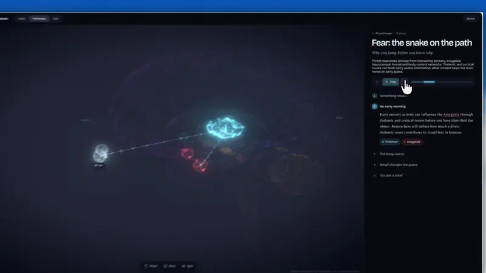

# Brain Explorer

> The human brain as a dynamic canvas for thought, feeling, and action.

**Live Demo**: [https://sarathavasarala.github.io/brain-explorer/](https://sarathavasarala.github.io/brain-explorer/)

Brain Explorer is an interactive 3D atlas designed for curious adults and learners who want to understand the mind without drowning in sterile textbook jargon.

<p align="center">
  <a href="https://youtu.be/Nhp8mNPcGss">
    
  </a>
  <br>
  <sub>Interactive 3D point-cloud atlas of the human brain · <a href="https://youtu.be/Nhp8mNPcGss">Watch full demo on YouTube (65 s)</a></sub>
</p>

---

## The Vision: The Brain as an Explanatory Canvas

Most neuroscience resources present the nervous system as a frozen anatomical catalogue. But the brain is not an inert museum specimen. It is an active organ of experience, constantly orchestrating thought, emotion, and movement across vastly different physical scales.

Brain Explorer treats the brain as an interactive visual canvas where explanations can be painted directly onto neural circuits. Instead of forcing you to stay at one layer of description, it lets you fluidly jump across levels of abstraction:

- **The Anatomical Canvas**: See lobes, deep nuclei, and brainstem waypoints light up within a responsive 3D point cloud.
- **The Chemical Currents**: Paint the brain with receptor density glows, trace ascending dopamine and serotonin projection fibres, and follow body-wide endocrine hormone axes linking brain commands to the heart, stomach, and adrenal glands.
- **The Cellular World**: Step down from whole-brain anatomy straight into microscopic morphology. Watch procedural 3D models of pyramidal cells, Purkinje fans, fast-spiking basket cells, and star-shaped astrocytes fire electrical action potentials and propagate calcium waves in real time.
- **The Human Experience**: Explore how physical circuits translate into everyday living. Tap your fingers, drop your keys, feel the alertness of unexpected surprise, or ask natural questions like *"what happens during a panic attack?"* to watch participating circuits illuminate together.

---

## Exploring Across Scales

### 1. Brain Parts (43 Structures)
Clinical atlases list hundreds of Latin subdivisions. To stay approachable for beginners and intermediate learners, the atlas curates 43 landmark parts across three spatial layers (**Cerebral cortex**, **Deep structures**, and **Brainstem & cerebellum**). Sub-parts are nested under their anatomical parent when they carry a distinct everyday job, clinical syndrome, or chemical pathway, while finer micro-circuits live inside the cell-level diagrams.

Every structure features an explainer with a three-level zoom ladder and perturbation scenarios:
1. **The part** (`overview`): Spatial location, physical boundaries, and everyday function with concrete analogies.
2. **How it connects** (`connects`): Animated 3D input and output arcs showing who talks to whom.
3. **Down to cells** (`cells`): Microscopic circuit architecture, synaptic mechanisms, and cell types.
- **What if scenarios**: Interactive perturbation states in "When it goes wrong" (damaged or removed, quiet, overdriven, reshaped) with 3D model reactions and real clinical cases.

### 2. Neurochemistry (17 Messengers)
Spans fast neurotransmitters, neuromodulators, and circulating endocrine hormones:
- **Fast Amino Acids** (Glutamate, GABA): Millisecond excitation and inhibition.
- **Neuromodulators** (Dopamine, Serotonin, Noradrenaline, Acetylcholine): Volume-broadcast networks tuning mood, vigilance, and focus.
- **Endocrine Hormones** (Cortisol, Adrenaline, Oxytocin, Vasopressin, Melatonin, Thyroid hormone, Leptin, Ghrelin, Growth hormone, Sex hormones, Prolactin): Multi-organ axes connecting the hypothalamus and pituitary down to visceral organs.
- **Interactive Synapse View**: Step through vesicle loading, exocytosis, receptor binding, and clearance, with toggles for common medications.

### 3. Cells & Morphology (14 Types)
Procedurally generated 3D cells spanning excitatory neurons, inhibitory interneurons, projection cells, and glia:
- **Excitatory**: Pyramidal neurons, cerebellar/hippocampal granule cells, thalamic relay neurons.
- **Inhibitory**: Purkinje cells, stellate cells, fast-spiking basket cells, axo-axonic chandelier cells, striatal medium spiny neurons.
- **Modulatory & Output**: Midbrain dopamine neurons, somatic motor neurons.
- **Glia**: Astrocytes (blood-brain barrier, glutamate clearance), oligodendrocytes (saltatory myelin), and microglia (synaptic pruning, immune surveillance).
- **Firing Sequencer**: An interactive step-through showing ion channel openings, voltage thresholds, and transmitter release.

### 4. Guided Pathways & Interactive Labs (20 Tours)
Narrative multi-step tours and hands-on lab experiments through brain systems, moving between 43 structures and 10 sensory, motor, and body anchors:
- **Everyday experiences (8)**: Seeing, smelling, moving, remembering, fear, hearing and speech, pain, and stress and fear.
- **Systems and networks (5)**: Dopamine, serotonin, noradrenaline, and acetylcholine pathways, plus the default mode network.
- **Interactive labs (7)**: Learning from surprise, receptor pharmacology, synaptic integration, action potentials, synaptic plasticity, neural rhythms, and sensory contrast.

### 5. Ask Mode ("Ask the Brain" Chat)
Ask natural questions about how your brain works, such as *"what happens when I fall asleep?"*, *"why does coffee wake me up?"*, or *"what happens in a panic attack?"*.

The brain acts as an explanatory canvas. The model returns a structured scene script, and Brain Explorer plays the script step by step in 3D. Brain regions light up with activity, neural pathways animate along 3D tracts, and chemical messengers glow in real time.

---

## Quickstart

Brain Explorer uses a zero-build, native ES module architecture. There is no bundler, no transpiler, and no framework overhead. Everything runs directly in the browser via Three.js import maps.

```sh
# Clone and enter the repository
git clone https://github.com/sarathavasarala/brain-explorer.git
cd brain-explorer

# Start the local server
npm start
```

Open `http://localhost:5173` in your browser (falls back to `5174` if busy). Set `PORT=5199 npm start` to pick another port.

The server binds to `127.0.0.1` by default. To reach it from another device on your private LAN or Tailscale network, set `ALLOW_LAN=1`. With LAN access enabled the server binds to `0.0.0.0` and prints a warning. Set `HOST` explicitly to override the bind address.

The local API endpoints are rate limited per client address. Defaults are 30 ask requests per minute and 1,000 per day, plus 8 chat requests per minute and 200 per day, with at most 4 concurrent chats. Override these with `ASK_RATE_PER_MIN`, `ASK_RATE_PER_DAY`, `CHAT_RATE_PER_MIN`, `CHAT_RATE_PER_DAY`, and `CHAT_MAX_CONCURRENT`.

### Ask Mode and Chat Setup

Brain Explorer provides hand-verified preset queries that work completely offline without API keys or a local server.

For live, free-form chat powered by Azure OpenAI, start the local server with `npm start` and configure your Azure OpenAI credentials in a `.env` file at the repository root:

```sh
# Azure OpenAI configuration for free-form chat
AZURE_OPENAI_ENDPOINT=https://your-resource.openai.azure.com/
AZURE_OPENAI_API_KEY=your-azure-api-key
AZURE_OPENAI_DEPLOYMENT=gpt-4o
AZURE_OPENAI_API_VERSION=2024-10-21

# Optional legacy TypeSafe Jev API key
TYPESAFE_API_KEY=your-typesafe-key
```

`server.py` securely proxies chat requests to `/api/chat` using only Python standard library modules, enforcing schema validation and keeping API keys safe on your machine.

On the static GitHub Pages build, you can connect your own Azure OpenAI or OpenAI key in the Ask dialog. By default the key lives in `sessionStorage` and disappears when the tab closes. Tick "Remember this key on this device" to opt into `localStorage` persistence across visits. The key is sent directly from the browser to the AI provider and is never sent to any proxy.

The service worker caches the app shell and the exact Three.js CDN modules after an online visit, so a reload can work offline. Same-origin app modules are refreshed in the background, and all other cross-origin requests are left alone.

`index.html` declares the content security policy, and `server.py` sends it with additional security headers (`Referrer-Policy`, `X-Content-Type-Options`, and `Permissions-Policy`). Client errors are reported to telemetry only after secrets and request bodies are removed.

### Content Validation
`npm run catalog` regenerates both `src/content/catalog.json` and `src/content/ai-contract.json`. The AI contract holds the shared system prompt and JSON schema used by the browser and `server.py`.

Run the built-in integrity checker to verify all cross-references, glossary terms, pathways, and diagrams, and to confirm both generated files are current:

```sh
npm run validate
```

---

## Navigation & Shortcuts

| Route | Description |
|---|---|
| `#/` | Whole brain overview (lateral view) |
| `#/s/<structure-id>/<level>` | Focus structure at level (`overview`, `connects`, `cells`) |
| `#/s/<structure-id>/<level>/<state>` | View perturbation scenario in 3D (`lesion`, `under`, `over`, `size`) |
| `#/chem/<chem-id>/<tab>` | Chemical lens (`overview`, `tracts`, `synapse`, `medicine`, `axis`) |
| `#/cell/<cell-id>/<tab>` | 3D cell view (`shape`, `fires`, `lives`, `chem`) |
| `#/pathways` or `#/p/<id>/<step>` | Guided pathway tours |
| `#/ask` or `#/ask/<query>` | Question interface and circuit highlighter |

**Keyboard Controls:**
- `ArrowRight` / `ArrowLeft`: Navigate between zoom levels, tabs, or tour steps.
- `ArrowUp` / `ArrowDown`: Step to previous or next item in the active category.
- `Escape`: Step back one level or return to whole-brain home.
- `Space`: Advance to next step in active guided tour.
- `K`: Play/pause active lab surface.
- `T`: Advance trial in active lab surface.

---

## Project Structure

```
brain-explorer/
├── index.html                  # Layout shell, Three.js CDN importmap, typography
├── styles.css                  # Single stylesheet: dark holographic theme, micro-animations
├── server.py                   # Python standard library static server and /api/ask and /api/chat proxy
├── package.json                # npm start, catalog, and validate scripts
├── tools/
│   ├── build-catalog.mjs       # Generates catalog.json and ai-contract.json
│   └── validate.mjs            # Integrity, completeness, and generated-file validator
└── src/
    ├── main.js                 # Hash router, state store, keyboard navigation
    ├── scene/
    │   ├── brain-scene.js      # 3D engine: point cloud shaders, bloom, camera, slice plane, body view
    │   ├── neuron.js           # Procedural 3D cell morphologies & firing animations
    │   ├── shapes.js           # Point-cloud generators (cortex gyri, ellipsoids, tubes, bands)
    │   └── noise.js            # Seeded random and 3D Perlin noise
    ├── content/
    │   ├── index.js            # Unified export & reference validation
    │   ├── catalog.json        # Generated catalog for the server prompt
    │   ├── ai-contract.js      # Shared system prompt and JSON schema builder
    │   ├── ai-contract.json    # Generated contract consumed by server.py
    │   ├── structures/         # Cortical lobes, deep nuclei, hindbrain structures
    │   ├── chemicals/          # Fast transmitters, neuromodulators, hormones
    │   ├── cells/              # Excitatory, inhibitory, modulatory, and glial types
    │   ├── pathways/           # Step-by-step guided tours and neural routes
    │   ├── diagrams/           # Microcircuit SVG diagrams with animated impulses
    │   ├── synapses.js         # Synaptic vesicle and receptor mechanism schemas
    │   ├── anchors.js          # Sensory endpoints and body organ anchors
    │   └── glossary/           # Definitions for [[term]] hover markup
    ├── services/
    │   ├── ask.js              # Preset and /api/ask client
    │   ├── chat.js             # BYOK and /api/chat client
    │   ├── errors.js           # Redacted client error reporter and global handlers
    │   └── telemetry.js        # Privacy-preserving page and event telemetry
    └── ui/
        ├── explainer.js        # Right card: 3-level zoom ladder, try-it, breaks
        ├── sidebar.js          # Unified search and Parts/Chemicals/Cells lists
        ├── chem.js             # Chemical explainer, fibre tracts, hormone axes
        ├── cell.js             # Cell explainer, morphology specs, firing sequencer
        ├── synapse-stepper.js  # Interactive synapse mechanism with drug toggles
        └── ask.js              # Ask query bar and spotlight cards
```

---

## Content Principles

All written content adheres to strict editorial rules:
1. **Beginner-Friendly Tone**: Plain, conversational, and grounded. Explain mechanisms using tangible physical analogies.
2. **Estimated Figures**: Use "about" or "roughly" instead of false precision.
3. **No Em Dashes**: Never use the em dash character. Always use commas, periods, or parentheses.
4. **No Filler or Hype Words**: Never use words like "fascinating", "incredible", "remarkable", "delve", "intricate", or "vital".
5. **Interactive Try-It**: Every structure and chemical includes a tangible physical or mental exercise the user can perform immediately.
